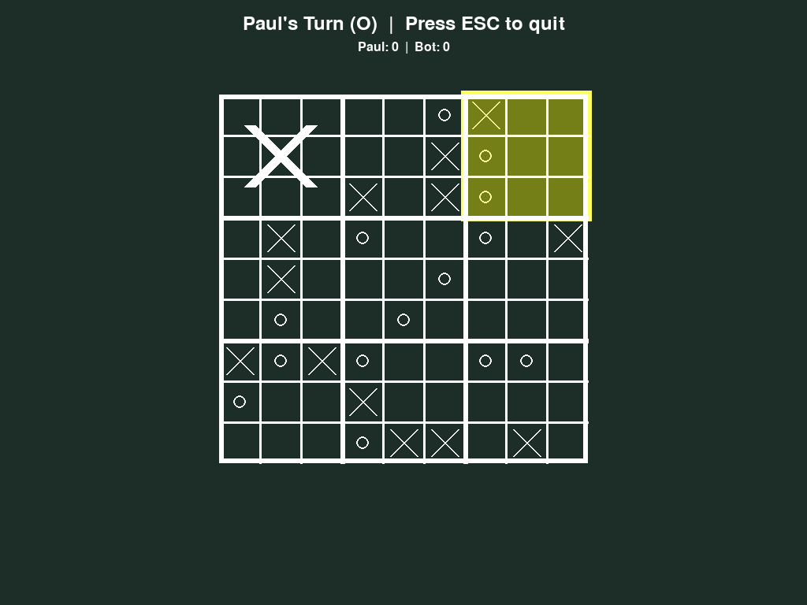

# Tic-Tac-Toe & Mega Tic-Tac-Toe

*[English](README.md) · Deutsch*

Ein Pygame-Spiel mit klassischem **3×3-Tic-Tac-Toe** und **Mega-Tic-Tac-Toe** (die 9×9-Variante
„Ultimate“), dazu ein Bot-Gegner in drei Schwierigkeitsstufen.



## Funktionen

- **Zwei Spielarten:** klassisch 3×3 und Mega 9×9. Bei Mega bestimmt dein Feld, auf welchem
  kleinen Brett der Gegner als Nächstes spielen muss; drei gewonnene Bretter in einer Reihe
  gewinnen.
- **Einzelspieler gegen einen Bot:** *leicht* (zufällig), *mittel* (gewinnt oder blockt, wenn
  möglich), *schwer* (Minimax, verliert bei 3×3 nie).
- **Zwei Spieler** an einem Rechner.
- **4 Farbthemen** und eigene Symbole.
- **Highscores und Verlauf:** Siege pro Tag und die Bretter der Spiele der letzten 10 Tage.
- Optionaler Sound (eigene Dateien, siehe [music/README.md](music/README.md)).

## Starten

Benötigt Python 3.10+.

```bash
pip install -r requirements.txt
python launch_gui.py
```

## Tests

```bash
python test_suite.py
```

## Lizenz & Entstehung

MIT-Lizenz, siehe [LICENSE](LICENSE).

Größtenteils mit KI-Unterstützung „gevibecodet“, wie der Startbildschirm zugibt. Spielidee,
Funktionsauswahl und Tests stammen von mir.
