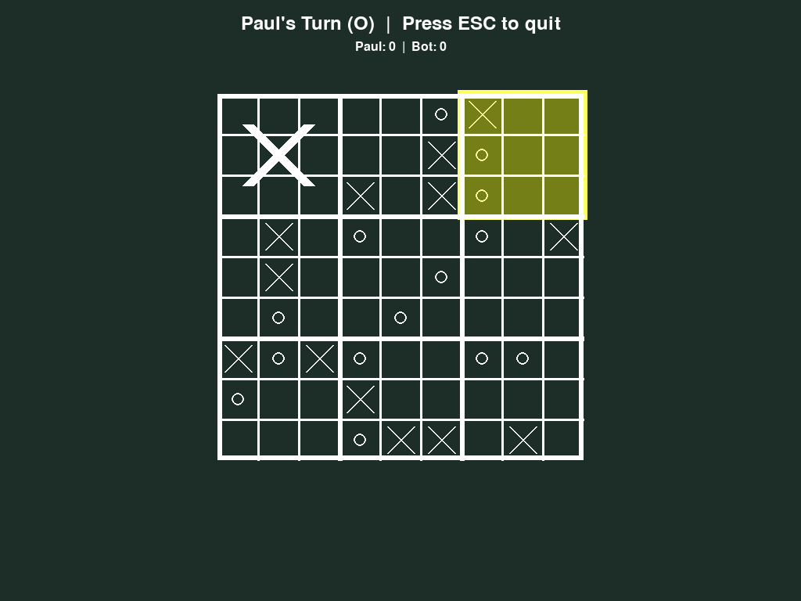
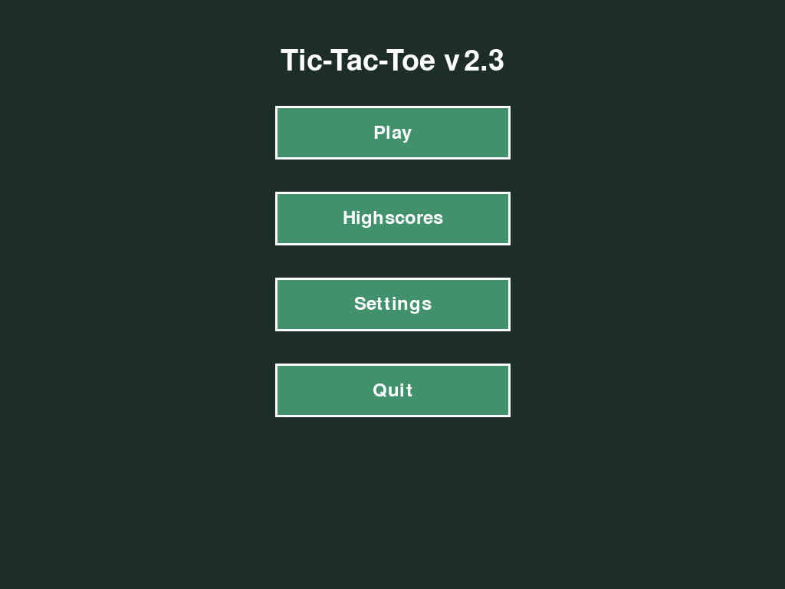

# Tic-Tac-Toe & Mega Tic-Tac-Toe

*English · [Deutsch](README.de.md)*

A Pygame desktop game with classic **3×3 Tic-Tac-Toe** and **Mega Tic-Tac-Toe** (the 9×9
"ultimate" variant), with a bot opponent on three difficulty levels.

| Mega Tic-Tac-Toe | Main menu |
|---|---|
|  |  |

## Features

- **Two game types:** classic 3×3 and Mega 9×9. In Mega, your cell decides which small board your
  opponent must play next, and three won boards in a row win the game.
- **Single player against a bot:** *easy* (random), *medium* (wins or blocks when it can),
  *hard* (minimax, so it never loses at 3×3).
- **Local two-player mode.**
- **4 colour themes** (Forest, Soft Desert, Misty Pastel, Ocean Breeze) and custom symbols.
- **Highscores and history:** daily win counts and the boards of the last 10 days' games.
- Optional sound (bring your own files, see [music/README.md](music/README.md)).

## Run

Requires Python 3.10+.

```bash
pip install -r requirements.txt
python launch_gui.py
```

Press `Space` to skip the start screen and `Esc` to quit.

## Tests

```bash
python test_suite.py      # 34 unittest tests: rules, bot, mega logic, input, themes, file I/O
```

## Structure

```
launch_gui.py            entry point, switches between game types
GUI/main.py              game logic: TicTacToe, MegaTicTacToe, bots
GUI/gui.py               Pygame game loops and menus
GUI/renderers/screen.py  all drawing
GUI/handlers/            mouse and keyboard input
GUI/constants.py         sizes and themes
GUI/sfx.py               optional music and sound effects
```

More detail in [docs/ARCHITECTURE.md](docs/ARCHITECTURE.md).

## License & credits

MIT, see [LICENSE](LICENSE).

Mostly vibecoded with AI assistance, as the start screen admits. The game design, feature ideas
and testing are mine.
